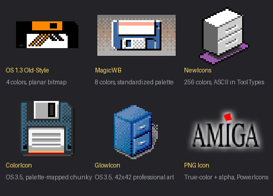
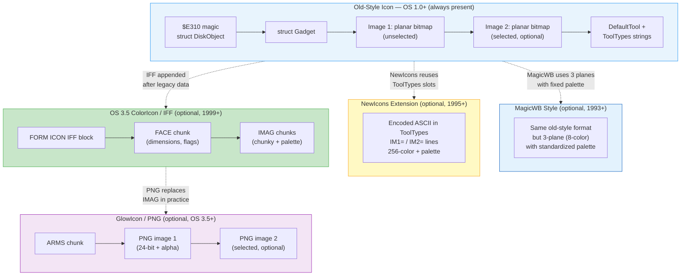
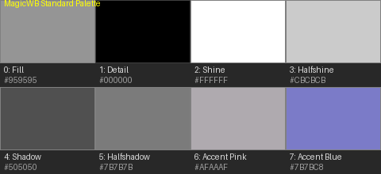
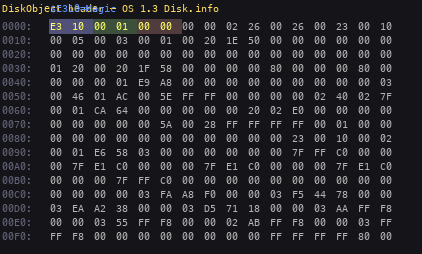
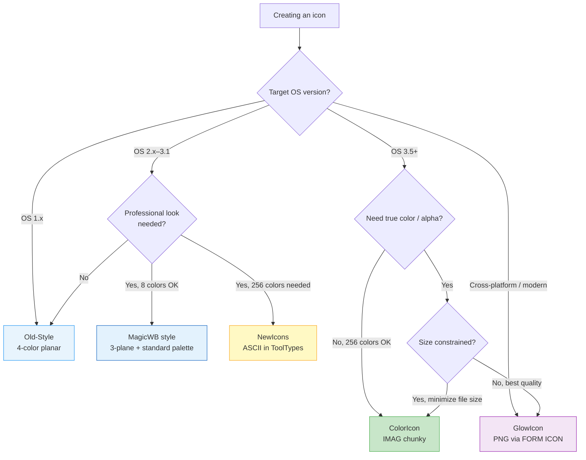

[← Home](../README.md) · [Libraries](README.md) · [icon.library API](icon.md)

# Icon File Format (.info) — Binary Layout, MagicWB, NewIcons, ColorIcons, GlowIcons

## Overview

Every file visible on the Workbench has a companion `.info` file — a binary container holding icon imagery, metadata (ToolTypes), default tool path, drawer window geometry, and stack size. The format evolved across **five generations**, each a response to the limitations of its predecessor:

1. **Old-Style Icons** (OS 1.0, 1985) — A raw memory dump of `struct DiskObject` with embedded planar bitmaps. Four colors, no palette, no transparency. Designed to be trivial to load on a 7 MHz 68000.
2. **MagicWB** (1993, Stefan Stuntz / SASG) — Not a new binary format, but a **standardized 8-color palette** and professional icon *style* layered on top of old-style planar icons. The first attempt to make Workbench look professional.
3. **NewIcons** (1995, Nicola Salmoria) — A third-party system that encoded 256-color images as ASCII in the ToolTypes array, because modifying the binary format would have broken every existing tool. Salmoria later created MAME.
4. **ColorIcons** (OS 3.5, 1999, Haage & Partner) — The first official color icon format: an IFF `FORM ICON` block appended after the legacy data, with palette-mapped chunky pixels and run-length encoding.
5. **GlowIcons / PNG Icons** (OS 3.5+, 1999) — True-color PNG bitmaps with 8-bit alpha, embedded inside the IFF block via `ARMS` chunks. The defining art style of AmigaOS 3.5/3.9, inspired by NeXTSTEP. Still the native format on AmigaOS 3.2 and 4.1.

The `.info` file is **big-endian** (Motorola byte order). It is **not** an IFF file — the old-style portion predates IFF and stores structures as serialized memory layouts with pointers replaced by booleans. Only the OS 3.5+ extension block uses IFF chunk syntax.

> [!IMPORTANT]
> **GlowIcons vs ColorIcons**: The term "GlowIcon" refers to the *art style* (vibrant gradients, soft shadows, a characteristic yellow glow on selected icons) — not a distinct binary format. The underlying container is the **ColorIcon** format (`FORM ICON` IFF block). A GlowIcon file may contain either palette-mapped `IMAG` chunks or PNG `ARMS` chunks. In practice, most GlowIcons use PNG data.

> [!WARNING]
> **Big-Endian Format**: All multi-byte values in `.info` files are stored in **Motorola (big-endian) byte order** — most significant byte first. If you are parsing these files on x86/ARM (little-endian), you **must** byte-swap every `UWORD` and `ULONG`.

---



---

## File Format Architecture — Five Generations Layered

The `.info` format is a **matryoshka doll**: each generation wraps the previous one for backward compatibility. An OS 3.5 GlowIcon still starts with the same `$E310` magic and `struct DiskObject` header that Workbench 1.0 would recognize — the new-format data is simply appended after the old-format payload.



### Format Identification

| Magic Bytes | Format | How to Detect |
|---|---|---|
| `$E3 0x10` at offset 0 | All formats | Check first 2 bytes; then scan for `FORM` block for ColorIcon/GlowIcon |
| Image depth = 3, no `FORM` or `IM1=` | MagicWB | 8-color planar icon using standardized MagicWB palette — no binary marker; detected heuristically |
| `FORM` `....` `ICON` after legacy data | OS 3.5 ColorIcon | Search for ASCII `FORM` after the old-style payload |
| `FORM` ... `ICON` ... `ARMS` chunk | GlowIcon (PNG) | The `ARMS` chunk inside `FORM ICON` contains raw PNG data |
| `IM1=` / `IM2=` in ToolTypes | NewIcons | Scan ToolTypes strings for these markers |

### Quick Detection from a Host Language

```python
import struct

def detect_icon_format(data: bytes) -> str:
    """Identify which icon generation a .info file belongs to."""
    if len(data) < 2:
        return "not_an_icon"
    magic = struct.unpack_from('>H', data, 0)[0]
    if magic != 0xE310:
        return "not_an_icon"

    # Search for FORM ICON block (OS 3.5+)
    form_pos = data.find(b'FORM')
    if form_pos > 0:
        # Check for ARMS chunk (GlowIcon / PNG)
        if data.find(b'ARMS', form_pos) > 0:
            return "glow_icon_png"
        # Check for FACE/IMAG chunks (ColorIcon)
        if data.find(b'FACE', form_pos) > 0:
            return "color_icon"

    # Search for NewIcons markers in raw data
    if data.find(b'IM1=') >= 0 or data.find(b'IM2=') >= 0:
        return "new_icon"

    # Check for MagicWB (3-plane old-style, no FORM or NewIcons)
    # Read Gadget.Flags at offset 0x0C (2 bytes), then Image.Depth
    # Gadget is at do_GadgetRender offset, typically starts at $04
    gadget_depth_off = 0x04 + 32  # Gadget.GadgetRender is a pointer-sized field
    # Image.Depth is at offset +16 within the Image struct
    if len(data) > gadget_depth_off + 16:
        img_depth = struct.unpack_from('>H', data, gadget_depth_off + 16)[0]
        if img_depth == 3:
            return "magicwb_style"  # heuristic — 8-color planar

    return "old_style"
```

---

## Old-Style Icons — Binary Layout (OS 1.0+)


The old-style format is essentially a **frozen memory dump**. When Commodore designed the `.info` file in 1985, they serialized the in-memory `struct DiskObject` directly to disk — replacing pointer fields with boolean flags (0 = absent, nonzero = present). This means the on-disk layout mirrors the Amiga's struct alignment exactly, including padding.

### DiskObject Header (offset `$00`–`$4E`)

The first 78 bytes of every `.info` file contain the fixed `DiskObject` header. This structure **never changes** — it is present in all five format generations.

| Offset | Size | Type | Field | Value / Notes |
|---|---|---|---|---|
| `$00` | 2 | `UWORD` | `do_Magic` | Always `$E310` (`WB_DISKMAGIC`) |
| `$02` | 2 | `UWORD` | `do_Version` | Always `1` (`WB_DISKVERSION`) |
| `$04` | 44 | `struct Gadget` | `do_Gadget` | Embedded gadget — see [Gadget Layout](#gadget-structure) below |
| `$30` | 1 | `UBYTE` | `do_Type` | Icon type: 1=disk, 2=drawer, 3=tool, 4=project, 5=garbage, 6=device, 7=kick, 8=appicon |
| `$31` | 1 | `UBYTE` | _pad_ | Undefined — usually 0 |
| `$32` | 4 | `ULONG` | `do_DefaultTool` | Boolean: nonzero = string follows later |
| `$36` | 4 | `ULONG` | `do_ToolTypes` | Boolean: nonzero = string array follows later |
| `$3A` | 4 | `LONG` | `do_CurrentX` | X position in drawer, or `$80000000` = `NO_ICON_POSITION` |
| `$3E` | 4 | `LONG` | `do_CurrentY` | Y position in drawer, or `$80000000` = `NO_ICON_POSITION` |
| `$42` | 4 | `ULONG` | `do_DrawerData` | Boolean: nonzero = `DrawerData` follows (drawers/disks only) |
| `$46` | 4 | `ULONG` | `do_ToolWindow` | Boolean: nonzero = string follows (never implemented in practice) |
| `$4A` | 4 | `LONG` | `do_StackSize` | Stack size in bytes; values < 4096 default to 4096 |

> [!NOTE]
> The pointer fields (`do_DefaultTool`, `do_ToolTypes`, etc.) are stored as **booleans on disk**, not real pointers. When `icon.library` reads the file, it checks each boolean: if nonzero, it reads the corresponding data block from the end of the file. This design was chosen because the original `PutDiskObject` simply wrote the struct verbatim — in 1985, zeroing pointer values and using their nonzero presence as a flag was the fastest serialization strategy.

### Gadget Structure (offset `$04`–`$2F`)

The `struct Gadget` embedded at offset `$04` carries the icon imagery metadata. Only a few fields are meaningful on disk — the rest are undefined.

```c
/* intuition/intuition.h — NDK39 */
struct Gadget {
    struct Gadget *NextGadget;   /* unused on disk — always 0 */
    WORD LeftEdge, TopEdge;     /* unused on disk */
    WORD Width, Height;         /* icon dimensions in pixels */
    UWORD Flags;                /* GFLG_GADGIMAGE always set; highlight mode */
    UWORD Activation;           /* unused on disk */
    UWORD GadgetType;           /* unused on disk */
    APTR GadgetRender;          /* boolean: nonzero = image 1 present */
    APTR SelectRender;          /* boolean: nonzero = image 2 (selected) present */
    struct IntuiText *GadgetText; /* unused — always 0 */
    LONG MutualExclude;         /* unused */
    APTR SpecialInfo;           /* unused */
    UWORD GadgetID;             /* unused */
    APTR UserData;              /* lower 8 bits: revision (0=old, 1=OS2.x+) */
};
```

| Offset | Size | Field | Meaning |
|---|---|---|---|
| `$04` | 4 | `NextGadget` | Undefined — always 0 |
| `$08` | 2 | `LeftEdge` | Unused |
| `$0A` | 2 | `TopEdge` | Unused |
| `$0C` | 2 | `Width` | Icon width in pixels |
| `$0E` | 2 | `Height` | Icon height in pixels |
| `$10` | 2 | `Flags` | Bit 2 (`GADGIMAGE`) always set; bits 0-1 select highlight mode |
| `$12` | 2 | `Activation` | Undefined |
| `$14` | 2 | `GadgetType` | Undefined |
| `$16` | 4 | `GadgetRender` | Boolean: nonzero = first image present |
| `$1A` | 4 | `SelectRender` | Boolean: nonzero = second (selected) image present |
| `$1E` | 4 | `GadgetText` | Undefined — always 0 |
| `$22` | 4 | `MutualExclude` | Undefined |
| `$26` | 4 | `SpecialInfo` | Undefined |
| `$2A` | 2 | `GadgetID` | Undefined |
| `$2C` | 4 | `UserData` | Lower 8 bits: revision flag (0=OS1.x, 1=OS2.x+) |

### Gadget Flags (bits 0-1 of `Flags` at offset `$10`)

| Bit 1 | Bit 0 | Mode | Behavior When Selected |
|---|---|---|---|
| 0 | 0 | `GADGHCOMP` | Invert colors within icon bounds |
| 0 | 1 | `GADGBACKFILL` | Invert, then flood-fill exterior to color 0 |
| 1 | 0 | `GADGHIMAGE` | Show alternate (selected) image |
| 1 | 1 | — | Invalid combination |

---

## Old-Style Payload — Images, DrawerData, Strings

After the 78-byte `DiskObject` header, the file contains a sequence of **optional data blocks** in a fixed order. Each block is present only if its corresponding boolean in the header is nonzero.

```mermaid
graph LR
    HDR["DiskObject Header<br/>78 bytes"]
    DD["DrawerData<br/>(if drawer/disk)"]
    IMG1["Image 1 struct<br/>+ planar bitmap data"]
    IMG2["Image 2 struct<br/>+ planar bitmap data<br/>(if selected image)"]
    DEF["DefaultTool<br/>string"]
    TT["ToolTypes<br/>string array"]
    TW["ToolWindow<br/>string (rare)"]
    DD2["DrawerData2<br/>(OS2.x extension)"]

    HDR --> DD --> IMG1 --> IMG2 --> DEF --> TT --> TW --> DD2

    style HDR fill:#e8f4fd,stroke:#2196f3,color:#333
    style DD fill:#fff9c4,stroke:#f9a825,color:#333
    style IMG1 fill:#c8e6c9,stroke:#4caf50,color:#333
    style IMG2 fill:#c8e6c9,stroke:#4caf50,color:#333
    style DEF fill:#fce4ec,stroke:#e91e63,color:#333
    style TT fill:#fce4ec,stroke:#e91e63,color:#333
```



### Image Structure

Each image is stored as a 20-byte `struct Image` header followed by the planar bitmap data.

```c
/* intuition/intuition.h — NDK39 */
struct Image {
    WORD  LeftEdge;      /* always 0 on disk */
    WORD  TopEdge;       /* always 0 on disk */
    WORD  Width;         /* pixel width */
    WORD  Height;        /* pixel height */
    WORD  Depth;         /* number of bitplanes (typically 2) */
    UWORD *ImageData;    /* boolean on disk: nonzero = data follows */
    UBYTE PlanePick;     /* foreground color register mask (typically 3) */
    UBYTE PlaneOnOff;    /* background color register (typically 0) */
    struct Image *NextImage; /* always NULL on disk */
};
```

| Offset (relative) | Size | Field | Notes |
|---|---|---|---|
| `+0x00` | 2 | `LeftEdge` | Always 0 |
| `+0x02` | 2 | `TopEdge` | Always 0 |
| `+0x04` | 2 | `Width` | Pixel width of image |
| `+0x06` | 2 | `Height` | Pixel height |
| `+0x08` | 2 | `Depth` | Number of bitplanes (usually 2 = 4 colors) |
| `+0x0A` | 4 | `ImageData` | Boolean: always nonzero = data follows |
| `+0x0E` | 1 | `PlanePick` | Which planes have data (bitmask, typically `$03`) |
| `+0x0F` | 1 | `PlaneOnOff` | Background color fill (typically `$00`) |
| `+0x10` | 4 | `NextImage` | Always 0 |

Immediately after this 20-byte header comes the **planar bitmap data**: `Depth` bitplanes, each `ceil(Width / 16) × Height` words in size. The width is always rounded up to the next 16-pixel boundary.

**Image data size formula:**

`bytes = Depth × ((Width + 15) / 16) × 2 × Height`

For a typical 4-color (2-plane) icon at 52×22 pixels:
`2 × ((52+15)/16) × 2 × 22 = 2 × 4 × 2 × 22 = 352 bytes`

### Planar Bitmap Encoding

The image data uses Amiga's native **interleaved planar format** (same as ILBM). Each bitplane is stored as a sequence of `UWORD` values, MSB first. Within each `UWORD`, the leftmost pixel is bit 15.

```
Plane 0:  bits select color register bit 0 (colors 0, 1)
Plane 1:  bits select color register bit 1 (colors 0, 2)

Pixel value = (plane1_bit << 1) | plane0_bit

0 = background    1 = color 1 (detail)
2 = color 2       3 = color 3 (fill)
```

The actual colors displayed depend on the Workbench palette — the icon file does **not** store a palette in old-style format.

### DrawerData Structure

Present only when `do_DrawerData` boolean is nonzero (disk and drawer icons). Stores window geometry for the drawer view.

| Offset (relative) | Size | Field | Notes |
|---|---|---|---|
| `+0x00` | 48 | `struct NewWindow` | Window position, size, min/max dimensions |
| `+0x30` | 4 | `dd_CurrentX` | Scroll X offset of drawer contents |
| `+0x34` | 4 | `dd_CurrentY` | Scroll Y offset of drawer contents |

If the icon's `Gadget.UserData` lower byte is `1` (OS 2.x+), an extended `DrawerData2` follows:

| Offset (relative) | Size | Field | Notes |
|---|---|---|---|
| `+0x00` | 4 | `dd_Flags` | Bit 0 = show icons, Bit 1 = show all files |
| `+0x04` | 2 | `dd_ViewModes` | 0=default, 1=by icon, 2=by name, 3=by date, 4=by size, 5=by type |

### Text Storage Format (DefaultTool, ToolTypes, ToolWindow)

All strings in old-style icons use a length-prefixed format:

```
Offset  Size   Field
+0x00   4      ULONG tx_Size    (length including NUL terminator)
+0x04   N      char[] tx_Text   (the string, NOT NUL-padded)
+0x04+N 1      UBYTE  tx_Zero   (NUL terminator)
```

For example, the text `"Hallo"` is encoded as: `00 00 00 06 48 61 6C 6C 6F 00`

**ToolTypes** use the same string format, but are preceded by a count value:

```
Offset  Size   Field
+0x00   4      ULONG tt_Count   (encoded as (numEntries + 1) × 4)
+0x04   ...    String[0]        (length-prefixed, as above)
...     ...    String[1]
...     ...    ... (last entry is always an empty string: 00 00 00 01 00)
```

> [!NOTE]
> The ToolTypes count is encoded as **(number of entries + 1) × 4**. This unusual encoding is an artifact of how the original BCPL-era code stored arrays — it represents the BCPL pointer arithmetic for array traversal. For 3 entries: `(3+1)×4 = 16 = $00000010`.

---

## MagicWB Icons (Stefan Stuntz / SASG, 1993)


MagicWB is not a separate binary format — it uses the same old-style planar icon structure. What makes MagicWB distinctive is its **standardized 8-color palette** and professional icon art style. Created by **Stefan Stuntz** (who also created MUI, the Magic User Interface), MagicWB was the first serious attempt to make the Workbench look professional.

### The MagicWB Palette



MagicWB uses **3 bitplanes** (8 colors) instead of the standard 2 bitplanes (4 colors). The palette was carefully designed to work on both OCS (4-bit per gun) and AGA (8-bit per gun) hardware:

| Color Index | Name | R | G | B | Typical Use |
|---|---|---|---|---|---|
| 0 | Fill | 149 | 149 | 149 | Window/icon background (grey) |
| 1 | Detail | 000 | 000 | 000 | Text and outlines (black) |
| 2 | Shine | 255 | 255 | 255 | Highlights and specular (white) |
| 3 | Halfshine | 203 | 203 | 203 | Top gradient / raised surfaces |
| 4 | Shadow | 080 | 080 | 080 | Bottom gradient / recessed surfaces |
| 5 | Halfshadow | 123 | 123 | 123 | Mid-gradient between halfshine and shadow |
| 6 | Accent (Pink) | 175 | 170 | 175 | Special highlights / error states |
| 7 | Accent (Blue) | 123 | 123 | 200 | Links / selected text / special items |

### Why MagicWB Was Revolutionary

Before MagicWB, Workbench icons used an arbitrary 4-color palette that varied between systems. A disk icon created on one Amiga might look completely different on another user's machine. MagicWB solved this by **standardizing the palette** so icons would look identical everywhere. The "MagicWB-Demon" background process managed color reallocation when switching screen modes or depths.

### Detecting MagicWB Icons

There is no binary marker for MagicWB icons — they are structurally identical to old-style planar icons. To detect one programmatically:

1. Check if the image depth is 3 (8 colors)
2. Verify there is no `FORM` block (not ColorIcon/GlowIcon)
3. Verify there are no `IM1=`/`IM2=` ToolTypes (not NewIcons)
4. Check if the palette matches (approximately) the MagicWB standard colors

### Relationship to Other Formats

MagicWB icons can coexist with NewIcons: a single `.info` file can contain a MagicWB-style planar image as the old-style fallback, plus NewIcons-encoded 256-color data in the ToolTypes. This was a common pattern for software that wanted to look good on all systems.

---

## NewIcons Extension (Nicola Salmoria, 1995)


The old-style format was stuck at **4 colors** with no palette — icons looked drab and identical. Italian programmer **Nicola Salmoria** (who later created **MAME**, the Multiple Arcade Machine Emulator) created **NewIcons** in **1995** to solve this without breaking the binary format. Subsequent development was done by **Eric Sauvageau** and **Phil Vedovatti**. The solution was brilliant in its hackery: encode 256-color images as ASCII text in the ToolTypes array.

NewIcons' key innovation was **backward compatibility through graceful degradation**. Instead of replacing the old planar image, it *added* the new color image as a hidden payload in the ToolTypes. If the user had NewIcons installed, they saw the 256-color version. If not, they fell back to the old-style 4-color image. This meant `.info` files remained portable across all Amiga systems.

Another critical innovation was **intelligent per-icon palette management**. Unlike Workbench, which used a fixed system palette (making icons look wrong at different screen depths), NewIcons stored a custom palette with each icon and dynamically remapped colors to the best available match on the current screen — a form of real-time color dithering.

> [!NOTE]
> NewIcons was released as **freeware** and quickly became the de facto color icon standard for AmigaOS 2.x–3.1 systems. It required only a 68000 CPU and 1 MB of RAM, making it accessible to the lowest-spec Amigas.

### How NewIcons Works

NewIcons appends special ToolTypes entries after the normal ones. The marker lines are:

```
" "
"*** DON'T EDIT THE FOLLOWING LINES!! ***"
```

After these markers, image data is encoded as ASCII using two prefixes:
- `IM1=` — image 1 (normal/unselected)
- `IM2=` — image 2 (selected, optional)

Each line is at most 128 bytes including the prefix and NUL terminator.

### NewIcons Image Header (first `IMx=` line)

| Offset | Type | Field | Encoding |
|---|---|---|---|
| `+0` | `UBYTE` | Transparency | `'B'` = transparent, `'C'` = opaque |
| `+1` | `UBYTE` | Width | Actual width = value - `$21` (so `'}'` = 92 px) |
| `+2` | `UBYTE` | Height | Actual height = value - `$21` |
| `+3` | `UWORD` | Colors | `((buf[3] - 0x21) << 6) + (buf[4] - 0x21)` |

Maximum dimensions: 93×93 pixels. Maximum colors: 256.

### NewIcons Encoding Algorithm

The image data and palette are encoded as a **7-bit-per-byte bitstream**:

| Byte Range | Meaning |
|---|---|
| `$20`–`$6F` | Represents 7-bit value `0x00`–`$4F` (80 values) |
| `$A1`–`$D0` | Represents 7-bit value `$50`–`$7F` (48 values) |
| `$D1`–`$FF` | RLE: repeat zero bits. `$D1` = 1×7 zeros, `$FF` = 47×7 zeros |

Unlike old-style icons, NewIcons stores pixel data in **chunky format** (one byte per pixel), not planar. Each pixel requires `ceil(log2(numColors))` bits.

> [!WARNING]
> NewIcons is **not** an official format. It is not understood by OS 3.1 icon.library or by Workbench itself without the NewIcons patch. On modern systems, `icon.library` v44+ can decode NewIcons transparently via `ICONCTRLA_SetGlobalNewIconsSupport`.

---

## OS 3.5 ColorIcons — FORM ICON IFF Block


AmigaOS 3.5 (1999, Haage & Partner) introduced the first **official** color icon format. Instead of hacking ToolTypes like NewIcons, the new data is stored as a standard **IFF `FORM ICON`** block appended after the old-style payload. This block is invisible to old software — `icon.library` v33-40 will simply ignore the trailing bytes.

> [!IMPORTANT]
> **ColorIcon is the format; GlowIcon is the style.** The `FORM ICON` IFF block can hold two types of image data:
> - **`IMAG` chunks** — palette-mapped chunky pixels (the original ColorIcon format, up to 256 colors)
> - **`ARMS` chunks** — raw PNG bitmaps (the GlowIcon format, true-color + alpha)
>
> Most OS 3.5/3.9 icons use PNG (`ARMS`) data and are commonly referred to as "GlowIcons."

### FORM ICON Structure

```
Offset  Size     Contents
+0x00   4 bytes  "FORM"           (IFF group identifier)
+0x04   4 bytes  ULONG size        (total size - 8, big-endian)
+0x08   4 bytes  "ICON"           (FORM type)
+0x0C   ...      IFF chunks (FACE, IMAG, etc.)
```

Each chunk follows standard IFF format: 4-byte tag, 4-byte big-endian size, data (padded to even length).

### FACE Chunk — Icon Frame Information

| Offset | Size | Field | Description |
|---|---|---|---|
| `+0x00` | 1 | `fc_Width` | Icon width - 1 (so `$32` = 51 px) |
| `+0x01` | 1 | `fc_Height` | Icon height - 1 |
| `+0x02` | 1 | `fc_Flags` | Bit 0 = frameless icon |
| `+0x03` | 1 | `fc_Aspect` | Upper 4 bits: X aspect, lower 4: Y aspect |
| `+0x04` | 2 | `fc_MaxPalBytes` | Max palette entries across images - 1 |

### IMAG Chunk — Image Data (one per image)

| Offset | Size | Field | Description |
|---|---|---|---|
| `+0x00` | 1 | `im_Transparent` | Transparent color index (if flag bit 0 set) |
| `+0x01` | 1 | `im_NumColors` | Number of colors - 1 |
| `+0x02` | 1 | `im_Flags` | Bit 0 = transparent color exists, Bit 1 = palette attached |
| `+0x03` | 1 | `im_ImageFormat` | 0 = uncompressed, 1 = RLE compressed |
| `+0x04` | 1 | `im_PalFormat` | Palette compression (same encoding as image) |
| `+0x05` | 1 | `im_Depth` | Bits per pixel (log2 of numColors) |
| `+0x06` | 2 | `im_ImageSize` | Image data size - 1 (big-endian) |
| `+0x08` | 2 | `im_PalSize` | Palette data size - 1 |
| `+0x0A` | ... | Image data | Chunky bytes (1 byte per pixel), optionally RLE |
| ... | ... | Palette data | RGB triplets (3 bytes per color) |

### RLE Compression (ByteRun1)

When `im_ImageFormat` or `im_PalFormat` is 1, the data uses the same **PackBits** RLE as IFF ILBM:

| Byte Value | Action |
|---|---|
| `$00`–`$7F` | Copy next **n+1** bytes literally |
| `$80` | NOP — skip this byte |
| `$81`–`$FF` | Repeat next byte **(257 - n)** times (signed: `n` is negative) |

---

## GlowIcons / PNG Icons (OS 3.5+, 1999)

When **Haage & Partner** took over AmigaOS development in the late 1990s, they officially retired the old 4-color icon system. AmigaOS 3.5 (1999) debuted with the first official **GlowIcon** set — a revolutionary icon collection designed by professional graphic designers and inspired by the **NeXTSTEP** graphical user interface.

### The GlowIcon Design Language

GlowIcons were a departure from everything that came before:

- **Vibrant gradients** — smooth color transitions instead of flat fills
- **Soft drop-shadows** — 8-bit alpha channel for pixel-perfect transparency
- **Photorealistic styling** — icons looked like miniature photographs
- **The signature "glow" effect** — a clear, illuminating outline on the selected-state image that indicated when an icon was highlighted

The standard GlowIcon size is **46×46 pixels** — larger than the old-style icons (which were typically 20–40 pixels). This gave artists room for detail without overwhelming the Workbench desktop.

### Historical Timeline

| Year | Event |
|---|---|
| 1993 | Stefan Stuntz releases **MagicWB** — standardized 8-color icon palette |
| 1995 | Nicola Salmoria releases **NewIcons** — 256-color icons encoded in ToolTypes |
| 1999 | **AmigaOS 3.5** ships with native GlowIcon support and a professional icon set |
| 2000 | **AmigaOS 3.9** expands the built-in GlowIcon library considerably |
| 2018 | **AmigaOS 3.1.4** (Hyperion Entertainment) revives classic development with GlowIcon support |
| 2021 | **AmigaOS 3.2** — over **2,100 GlowIcon-style icons** included on the CD-ROM as an installable option (not present on `.adf` floppy images) |
| Present | **AmigaOS 4.x** (PowerPC) continues to use the GlowIcon standard natively |

### PNG Icons: The Binary Format


PNG icons embed standard **PNG files** inside the `FORM ICON` IFF block. This gives full 24-bit RGB color with an 8-bit alpha channel — the same image quality as modern desktop icons.

### PNG Icon Structure

PNG icons live inside the `FORM ICON` block using the `ARMS` chunks (the chunk ID is literally the ASCII string `ARMS`):

```
FORM ICON {
    FACE chunk    (dimensions + flags — same as ColorIcon)
    ARMS chunk    (PNG image 1: unselected state)
    ARMS chunk    (PNG image 2: selected state, optional)
}
```

The `ARMS` chunk contains a **complete, standard PNG file** verbatim — no re-encoding. Any PNG reader can extract and decode it directly.

### Extracting a PNG from a .info File

```python
import struct

def extract_png_icons(data: bytes) -> list[bytes]:
    """Extract all PNG images embedded in a .info file."""
    pngs = []
    pos = 0
    while True:
        pos = data.find(b'ARMS', pos)
        if pos < 0:
            break
        # Read chunk size (4 bytes before the tag in IFF format,
        # but ARMS uses IFF convention: size is BEFORE the tag)
        chunk_size = struct.unpack_from('>I', data, pos - 4)[0]
        png_data = data[pos + 4 : pos + 4 + chunk_size]
        # Verify it's a valid PNG
        if png_data[:4] == b'\x89PNG':
            pngs.append(png_data)
        pos += 4
    return pngs
```

### PNG Icon Constraints

| Property | Constraint |
|---|---|
| Max size | Typically 46×46 to 64×64 pixels (no hard limit, but Workbench clips) |
| Color depth | 24-bit RGB + 8-bit alpha (RGBA) |
| Transparency | Full 8-bit alpha channel |
| Compression | Standard PNG deflate |
| Interlacing | Adam7 interlacing supported but discouraged (slower to load) |
| Gamma | sRGB recommended; no gamma correction applied by icon.library |

> [!NOTE]
> The **FACE chunk** is still required for PNG icons — it carries the icon dimensions that Workbench uses for layout. The actual PNG dimensions must match.

### What GlowIcons Look Like in Practice


These are real GlowIcons extracted from actual `.info` files. Left: a Games drawer icon. The icons use smooth gradients, anti-aliased edges, and the characteristic 42×42 pixel canvas. Compare these to the flat 4-color old-style icons above to see why GlowIcons were revolutionary for the Amiga desktop.

GlowIcons were notable for their **anti-aliased edges** and smooth gradients. On the standard 4-color Workbench palette, these icons look like photographs compared to the flat, blocky old-style icons. The 8-bit alpha channel allows icons to have soft shadows and transparent backgrounds that blend seamlessly with any Workbench wallpaper.

---

## API Reference — Reading and Writing Icons

The `icon.library` provides two API layers: the **classic API** (OS 1.0+, used via `GetDiskObject`/`PutDiskObject`) and the **tag-based API** (OS 3.5+, `GetIconTagList`/`PutIconTagList`/`IconControlA`). The tag-based API is required for ColorIcons and PNG icons.

### Classic API (OS 1.0+)

| Function | LVO | Description |
|---|---|---|
| `GetDiskObject(name)` | `-30` | Load `.info` file into `DiskObject` struct |
| `PutDiskObject(name, dobj)` | `-36` | Write `DiskObject` to `.info` file |
| `FreeDiskObject(dobj)` | `-42` | Free a `DiskObject` from `GetDiskObject` |
| `FindToolType(ttArray, name)` | `-48` | Look up a ToolType by name, return its value |
| `MatchToolValue(typeStr, value)` | `-54` | Check if a value is in a pipe-separated ToolType |
| `BumpRevision(newname, oldname)` | `-60` | Generate a unique copy name ("copy_1_of_file") |
| `AddFreeList(fl, mem, size)` | `-66` | Add allocated memory to a FreeList |
| `FreeFreeList(fl)` | `-72` | Free all memory in a FreeList |
| `GetDefDiskObject(type)` | `-78` | Get the system default icon for a type |
| `PutDefDiskObject(dobj)` | `-84` | Replace a default icon |
| `GetDiskObjectNew(name)` | `-90` | Like `GetDiskObject`, but returns a default if no `.info` exists |
| `DeleteDiskObject(name)` | `-96` | Delete a `.info` file from disk |

> [!WARNING]
> **Classic API only reads old-style and NewIcons data.** It does not return ColorIcon or PNG image data. To access palette-mapped or PNG icons, use the tag-based API with `GetIconTagList()`.

### Tag-Based API (OS 3.5+, icon.library v44+)

The modern API uses TagItems for extensible parameters:

```c
/* workbench/icon.h — NDK 3.9/3.2 */

/* GetIconTagList tags */
#define ICONGETA_GetDefaultType        (ICONA_Dummy+45)
#define ICONGETA_GetDefaultName        (ICONA_Dummy+46)
#define ICONGETA_FailIfUnavailable     (ICONA_Dummy+47)
#define ICONGETA_GetPaletteMappedIcon  (ICONA_Dummy+48)  /* request chunky data */
#define ICONGETA_IsDefaultIcon         (ICONA_Dummy+49)
#define ICONGETA_RemapIcon             (ICONA_Dummy+50)
#define ICONGETA_GenerateImageMasks    (ICONA_Dummy+51)
#define ICONGETA_Label                 (ICONA_Dummy+52)
#define ICONGETA_Screen                (ICONA_Dummy+69)

/* PutIconTagList tags */
#define ICONPUTA_NotifyWorkbench       (ICONA_Dummy+53)
#define ICONPUTA_PutDefaultType        (ICONA_Dummy+54)
#define ICONPUTA_DropPlanarIconImage   (ICONA_Dummy+56)  /* save space */
#define ICONPUTA_DropChunkyIconImage   (ICONA_Dummy+57)
#define ICONPUTA_DropNewIconToolTypes  (ICONA_Dummy+58)
#define ICONPUTA_OnlyUpdatePosition    (ICONA_Dummy+72)

/* IconControlA tags — per-icon settings */
#define ICONCTRLA_GetImageData1       (ICONA_Dummy+29)   /* chunky pixel data */
#define ICONCTRLA_GetImageData2       (ICONA_Dummy+31)
#define ICONCTRLA_SetPalette1         (ICONA_Dummy+20)
#define ICONCTRLA_GetPalette1         (ICONA_Dummy+21)
#define ICONCTRLA_GetImageMask1       (ICONA_Dummy+14)   /* transparency mask */
#define ICONCTRLA_SetFrameless        (ICONA_Dummy+32)
#define ICONCTRLA_GetWidth            (ICONA_Dummy+39)
#define ICONCTRLA_GetHeight           (ICONA_Dummy+41)
#define ICONCTRLA_IsPaletteMapped     (ICONA_Dummy+42)   /* is this a ColorIcon? */
#define ICONCTRLA_HasRealImage2       (ICONA_Dummy+44)   /* has selected image? */
#define ICONCTRLA_IsNewIcon           (ICONA_Dummy+79)   /* is this a NewIcon? */
#define ICONCTRLA_IsNativeIcon        (ICONA_Dummy+80)   /* allocated by icon.library? */
```

### Key Function Prototypes

```c
/* clib/icon_protos.h — NDK 3.2 (V47) */

/* Read an icon (OS 3.5+) */
struct DiskObject *GetIconTagList(CONST_STRPTR name,
    CONST struct TagItem *tags);

/* Write an icon (OS 3.5+) */
BOOL PutIconTagList(CONST_STRPTR name,
    CONST struct DiskObject *icon,
    CONST struct TagItem *tags);

/* Query/set icon properties (OS 3.5+) */
ULONG IconControlA(struct DiskObject *icon,
    CONST struct TagItem *tags);

/* Duplicate an icon with selective deep-copy (OS 3.5+) */
struct DiskObject *DupDiskObjectA(
    CONST struct DiskObject *diskObject,
    CONST struct TagItem *tags);

/* Create a new icon from scratch (OS 3.5+) */
struct DiskObject *NewDiskObject(LONG type);

/* Draw an icon at a given position/state (OS 3.5+) */
VOID DrawIconStateA(struct RastPort *rp,
    CONST struct DiskObject *icon,
    CONST_STRPTR label,
    LONG leftOffset, LONG topOffset,
    ULONG state, CONST struct TagItem *tags);

/* Get the bounding rectangle of an icon (OS 3.5+) */
BOOL GetIconRectangleA(struct RastPort *rp,
    CONST struct DiskObject *icon,
    CONST_STRPTR label,
    struct Rectangle *rect,
    CONST struct TagItem *tags);
```

### Icon States (for `DrawIconStateA`)

| State Constant | Value | Description |
|---|---|---|
| `IDS_NORMAL` | 0 | Unselected, normal display |
| `IDS_SELECTED` | 1 | Selected (highlighted) display |
| `IDS_NORMALSELECTED` | 2 | Partially selected (in drag) |
| `IDS_INACTIVENORMAL` | 3 | Unselected, window inactive |
| `IDS_INACTIVESELECTED` | 4 | Selected, window inactive |

---

## Practical Examples

### Example 1: Creating an Old-Style Icon from Scratch

This creates a simple 4-color planar icon using the classic API. The image data is hardcoded as planar bitplane arrays — the same format stored in the `.info` file.

```c
#include <exec/types.h>
#include <workbench/workbench.h>
#include <clib/icon_protos.h>
#include <proto/exec.h>
#include <stdio.h>

/* 16x16 icon, 2 planes (4 colors) — a simple folder shape */
/* Plane 0: outline */
static UWORD img_plane0[16] = {
    0x07FF, 0x0801, 0x0801, 0x0801, 0x0801, 0x0801, 0x0801, 0x0801,
    0x0801, 0x0801, 0x0801, 0x0801, 0x0801, 0x0801, 0x0801, 0x0FFE,
};
/* Plane 1: fill */
static UWORD img_plane1[16] = {
    0x07FF, 0x0FFF, 0x0FFF, 0x0FFF, 0x0FFF, 0x0FFF, 0x0FFF, 0x0FFF,
    0x0FFF, 0x0FFF, 0x0FFF, 0x0FFF, 0x0FFF, 0x0FFF, 0x0FFF, 0x0FFE,
};

static UWORD *img_data[] = { img_plane0, img_plane1 };

static struct Image icon_img = {
    0, 0,           /* LeftEdge, TopEdge */
    16, 16, 2,      /* Width, Height, Depth */
    img_data,       /* ImageData (will be adjusted below) */
    0x03, 0x00,     /* PlanePick=3, PlaneOnOff=0 */
    NULL            /* NextImage */
};

int main(void)
{
    struct Library *IconBase = OpenLibrary("icon.library", 0);
    if (!IconBase) {
        printf("Cannot open icon.library\n");
        return 20;
    }

    /* Build a DiskObject */
    struct DiskObject dobj = {0};
    dobj.do_Magic = WB_DISKMAGIC;
    dobj.do_Version = WB_DISKVERSION;
    dobj.do_Gadget.LeftEdge = 0;
    dobj.do_Gadget.TopEdge = 0;
    dobj.do_Gadget.Width = 16;
    dobj.do_Gadget.Height = 16;
    dobj.do_Gadget.Flags = GFLG_GADGIMAGE | GFLG_GADGHCOMP;
    dobj.do_Gadget.GadgetRender = &icon_img;
    dobj.do_Type = WBTOOL;
    dobj.do_DefaultTool = NULL;
    dobj.do_ToolTypes = NULL;
    dobj.do_CurrentX = NO_ICON_POSITION;
    dobj.do_CurrentY = NO_ICON_POSITION;
    dobj.do_StackSize = 4096;

    /* Write the .info file */
    if (PutDiskObject("RAM:MyTool", &dobj))
        printf("Icon created: RAM:MyTool.info\n");
    else
        printf("Failed to create icon\n");

    CloseLibrary(IconBase);
    return 0;
}
```

> [!NOTE]
> The `img_data` pointer in `icon_img.ImageData` must point to a **contiguous array** of bitplane data. When writing to disk, `icon.library` serializes `Depth` planes, each `((Width+15)/16)*2*Height` bytes in size. The planes are stored consecutively: plane 0 first, then plane 1.

### Example 2: Reading an Icon and Extracting Image Data

This example reads a `.info` file and dumps the planar bitmap data, demonstrating how to access the raw image bytes.

```c
#include <workbench/workbench.h>
#include <clib/icon_protos.h>
#include <proto/exec.h>
#include <stdio.h>

int main(int argc, char **argv)
{
    struct Library *IconBase;
    struct DiskObject *dobj;
    struct Image *img;
    int plane, row, col;
    UWORD *data;

    if (argc < 2) {
        printf("Usage: %s <icon-name>\n", argv[0]);
        return 20;
    }

    IconBase = OpenLibrary("icon.library", 0);
    if (!IconBase) return 20;

    dobj = GetDiskObject(argv[1]);
    if (!dobj) {
        printf("Cannot read icon for %s\n", argv[1]);
        CloseLibrary(IconBase);
        return 20;
    }

    /* Access the first image (unselected state) */
    img = (struct Image *)dobj->do_Gadget.GadgetRender;
    if (img) {
        int words_per_row = (img->Width + 15) / 16;
        int plane_size = words_per_row * img->Height;

        printf("Image: %dx%d, %d planes\n",
               img->Width, img->Height, img->Depth);
        printf("Data per plane: %d words\n", plane_size);

        data = img->ImageData;
        for (plane = 0; plane < img->Depth; plane++) {
            printf("--- Plane %d ---\n", plane);
            for (row = 0; row < img->Height; row++) {
                printf("  ");
                for (col = 0; col < words_per_row; col++) {
                    printf("%04X ", data[row * words_per_row + col]);
                }
                printf("\n");
            }
            data += plane_size; /* advance to next plane */
        }
    }

    /* Print metadata */
    printf("Type: %d\n", dobj->do_Type);
    printf("Stack: %ld\n", dobj->do_StackSize);
    if (dobj->do_DefaultTool)
        printf("Default tool: %s\n", dobj->do_DefaultTool);

    /* Print ToolTypes */
    if (dobj->do_ToolTypes) {
        char **tt = dobj->do_ToolTypes;
        while (*tt) {
            printf("  ToolType: %s\n", *tt);
            tt++;
        }
    }

    FreeDiskObject(dobj);
    CloseLibrary(IconBase);
    return 0;
}
```

### Example 3: Creating a PNG Icon (OS 3.5+)

This example creates a true-color PNG icon using the modern tag-based API.

```c
#include <workbench/workbench.h>
#include <workbench/icon.h>
#include <proto/icon.h>
#include <proto/exec.h>
#include <stdio.h>

/* You would typically load this PNG data from a file */
/* Here we use a placeholder — replace with actual PNG bytes */
extern UBYTE png_normal_data[];   /* unselected PNG */
extern ULONG png_normal_size;
extern UBYTE png_selected_data[]; /* selected PNG */
extern ULONG png_selected_size;

int main(void)
{
    struct Library *IconBase;
    struct DiskObject *icon;
    LONG error = 0;

    IconBase = OpenLibrary("icon.library", 44); /* OS 3.5+ */
    if (!IconBase) {
        printf("Need icon.library V44+\n");
        return 20;
    }

    /* Create a new project icon */
    icon = NewDiskObject(WBPROJECT);
    if (!icon) {
        CloseLibrary(IconBase);
        return 20;
    }

    /* Set up chunky image data and palette via IconControlA */
    /* For PNG icons, icon.library handles PNG storage internally */
    /* when you write with PutIconTagList */
    icon->do_DefaultTool = "SYS:Utilities/MultiView";
    icon->do_StackSize = 8192;
    icon->do_CurrentX = NO_ICON_POSITION;
    icon->do_CurrentY = NO_ICON_POSITION;

    char *tooltypes[] = {
        "PUBSCREEN=Workbench",
        NULL
    };
    icon->do_ToolTypes = tooltypes;

    /* Write the icon with PNG data */
    struct TagItem put_tags[] = {
        { ICONPUTA_NotifyWorkbench, TRUE },
        { TAG_END, 0 }
    };

    /* To embed PNG data, you need to set it via IconControlA first:
     *
     * IconControlA(icon, TagItems:
     *   ICONCTRLA_SetImageData1, png_chunky_data,
     *   ICONCTRLA_SetPalette1,    palette,
     *   ICONCTRLA_SetWidth,       46,
     *   ICONCTRLA_SetHeight,      46,
     *   TAG_END);
     *
     * Then PutIconTagList will serialize it as a FORM ICON block.
     *
     * Alternatively, for direct PNG embedding, use the raw file
     * manipulation approach shown in the Python example below.
     */

    if (PutIconTagList("RAM:MyPNGIcon", icon, put_tags))
        printf("PNG icon created\n");
    else
        printf("Failed\n");

    FreeDiskObject(icon);
    CloseLibrary(IconBase);
    return 0;
}
```

### Example 4: Embedding a PNG into a .info File (Python)

For tooling outside AmigaOS (build scripts, icon editors on macOS/Linux), you can construct a `.info` file directly:

```python
import struct

def create_png_info_file(output_path: str, png_data: bytes,
                         icon_type: int = 3,  # WBTOOL
                         tool_types: list[str] = None,
                         default_tool: str = None,
                         stack_size: int = 4096):
    """Create a minimal .info file with an embedded PNG icon."""

    # --- 1. DiskObject header (78 bytes) ---
    # We need valid old-style data for backward compatibility,
    # but the real image is in the FORM ICON block.

    # Create a tiny 1x1 placeholder planar image
    placeholder_width = 1
    placeholder_height = 1
    placeholder_depth = 1
    placeholder_data = struct.pack('>H', 0x8000)  # 1 pixel set

    # Gadget structure (44 bytes)
    gadget = struct.pack('>I', 0)           # NextGadget (NULL)
    gadget += struct.pack('>hh', 0, 0)      # LeftEdge, TopEdge
    gadget += struct.pack('>hh', placeholder_width, placeholder_height)
    gadget += struct.pack('>HH', 0x0006, 0)  # Flags=GADGIMAGE|GADGHCOMP, Activation
    gadget += struct.pack('>HH', 0, 0)      # GadgetType, padding
    gadget += struct.pack('>I', 1)           # GadgetRender (boolean=1)
    gadget += struct.pack('>I', 0)           # SelectRender (boolean=0)
    gadget += struct.pack('>I', 0)           # GadgetText (NULL)
    gadget += struct.pack('>I', 0)           # MutualExclude
    gadget += struct.pack('>I', 0)           # SpecialInfo
    gadget += struct.pack('>H', 0)           # GadgetID
    gadget += struct.pack('>I', 1)           # UserData (revision=1, OS2.x+)

    # Image structure (20 bytes)
    img_header = struct.pack('>hh', 0, 0)              # LeftEdge, TopEdge
    img_header += struct.pack('>hhH', placeholder_width, placeholder_height, placeholder_depth)
    img_header += struct.pack('>I', 1)                   # ImageData (boolean=1)
    img_header += struct.pack('>BB', 1, 0)              # PlanePick=1, PlaneOnOff=0
    img_header += struct.pack('>I', 0)                   # NextImage (NULL)

    # DiskObject header
    header = struct.pack('>HH', 0xE310, 1)  # Magic, Version
    header += gadget                          # do_Gadget
    header += struct.pack('>B', icon_type)    # do_Type
    header += struct.pack('>B', 0)            # pad
    header += struct.pack('>I', 1 if default_tool else 0)  # do_DefaultTool boolean
    header += struct.pack('>I', 1 if tool_types else 0)    # do_ToolTypes boolean
    header += struct.pack('>i', 0x80000000)   # do_CurrentX = NO_ICON_POSITION
    header += struct.pack('>i', 0x80000000)   # do_CurrentY = NO_ICON_POSITION
    header += struct.pack('>I', 0)            # do_DrawerData (boolean=0)
    header += struct.pack('>I', 0)            # do_ToolWindow (boolean=0)
    header += struct.pack('>i', stack_size)   # do_StackSize

    # --- 2. Payload: image data ---
    payload = img_header + placeholder_data

    # --- 3. DefaultTool string ---
    if default_tool:
        dt_bytes = default_tool.encode('ascii') + b'\x00'
        payload += struct.pack('>I', len(dt_bytes)) + dt_bytes

    # --- 4. ToolTypes ---
    if tool_types:
        count = len(tool_types)
        encoded_count = (count + 1) * 4  # BCPL encoding
        payload += struct.pack('>I', encoded_count)
        for tt in tool_types:
            tt_bytes = tt.encode('ascii') + b'\x00'
            payload += struct.pack('>I', len(tt_bytes)) + tt_bytes
        # Empty terminator string
        payload += struct.pack('>I', 1) + b'\x00'

    # --- 5. FORM ICON block with PNG ---
    # Get PNG dimensions from IHDR chunk
    if png_data[:8] == b'\x89PNG\r\n\x1a\n':
        ihdr_width = struct.unpack('>I', png_data[16:20])[0]
        ihdr_height = struct.unpack('>I', png_data[20:24])[0]
    else:
        raise ValueError("Invalid PNG data")

    # FACE chunk
    face_data = struct.pack('>BB', ihdr_width - 1, ihdr_height - 1)
    face_data += struct.pack('>BB', 0, 0x11)  # flags=0, aspect=1:1
    face_data += struct.pack('>H', 0)         # max pal bytes
    face_chunk = b'FACE' + struct.pack('>I', len(face_data)) + face_data
    if len(face_data) % 2: face_chunk += b'\x00'  # pad to even

    # ARMS chunk (the PNG data)
    arms_chunk = b'ARMS' + struct.pack('>I', len(png_data)) + png_data
    if len(png_data) % 2: arms_chunk += b'\x00'

    # FORM ICON wrapper
    form_content = b'ICON' + face_chunk + arms_chunk
    form_block = b'FORM' + struct.pack('>I', len(form_content)) + form_content

    # --- Assemble the file ---
    data = header + payload + form_block

    with open(output_path, 'wb') as f:
        f.write(data)

    print(f"Created {output_path}: {len(data)} bytes")
    print(f"  PNG: {ihdr_width}x{ihdr_height}, {len(png_data)} bytes")
```

### Example 5: Extracting and Visualizing Icon Images (Python)

```python
import struct
from PIL import Image

def extract_and_render_icon(info_path: str, output_png: str):
    """Extract icon image from .info file and render as PNG."""
    with open(info_path, 'rb') as f:
        data = f.read()

    # Try PNG first (ARMS chunk)
    pos = 0
    while True:
        pos = data.find(b'ARMS', pos)
        if pos < 0:
            break
        chunk_size = struct.unpack_from('>I', data, pos - 4)[0]
        png_data = data[pos + 4 : pos + 4 + chunk_size]
        if png_data[:8] == b'\x89PNG\r\n\x1a\n':
            # Found a PNG — save it directly
            with open(output_png, 'wb') as f:
                f.write(png_data)
            print(f"Extracted PNG icon to {output_png}")
            return
        pos += 4

    # No PNG — try old-style planar
    magic = struct.unpack_from('>H', data, 0)[0]
    if magic != 0xE310:
        print("Not an icon file")
        return

    width = struct.unpack_from('>h', data, 0x0C)[0]
    height = struct.unpack_from('>h', data, 0x0E)[0]
    depth = struct.unpack_from('>h', data, 0x08 + 0x0A)[0]  # image depth

    # Standard Workbench 4-color palette (blue, white, black, orange)
    wb_palette = [
        (108, 108, 108),   # color 0: grey-blue
        (255, 255, 255),   # color 1: white
        (0, 0, 0),         # color 2: black
        (115, 82, 255),    # color 3: blue-purple
    ]

    # Find the image data (after header + optional drawerdata)
    # For simplicity, search for the image by its known width/height
    # The image struct starts right after the DiskObject header (78 bytes)
    # unless DrawerData is present

    img_offset = 78  # right after header (no drawerdata for tools)
    img_width = struct.unpack_from('>h', data, img_offset + 4)[0]
    img_height = struct.unpack_from('>h', data, img_offset + 6)[0]
    img_depth = struct.unpack_from('>h', data, img_offset + 8)[0]

    words_per_row = (img_width + 15) // 16
    data_offset = img_offset + 20  # after Image struct
    bytes_per_plane = words_per_row * 2 * img_height

    img = Image.new('RGB', (img_width, img_height))
    pixels = img.load()

    for y in range(img_height):
        for x in range(img_width):
            word_idx = x // 16
            bit_idx = 15 - (x % 16)

            color = 0
            for plane in range(img_depth):
                plane_start = data_offset + plane * bytes_per_plane
                word_offset = plane_start + (y * words_per_row + word_idx) * 2
                word = struct.unpack_from('>H', data, word_offset)[0]
                if word & (1 << bit_idx):
                    color |= (1 << plane)

            pixels[x, y] = wb_palette[color % len(wb_palette)]

    img.save(output_png)
    print(f"Rendered planar icon to {output_png} ({img_width}x{img_height}, {1 << img_depth} colors)")
```



---

## Decision Guide — Which Format to Use



### Format Comparison Matrix

| Criterion | Old-Style | MagicWB | NewIcons | ColorIcon | GlowIcon/PNG |
|---|---|---|---|---|---|
| **Max colors** | 4 | 8 (fixed palette) | 256 | 256 | 16M (24-bit) |
| **Alpha transparency** | None (1-bit mask) | None (1-bit mask) | None | None (color key) | Full 8-bit alpha |
| **File size (46×46 icon)** | ~1-2 KB | ~2-3 KB | ~3-5 KB | ~4-8 KB | ~5-15 KB |
| **Min OS version** | 1.0 | 2.0+ | 2.0+ (with patch) | 3.5 | 3.5 |
| **Official support** | Yes | Third-party | No (third-party) | Yes | Yes |
| **Creator** | Commodore | Stefan Stuntz | Nicola Salmoria | Haage & Partner | Haage & Partner |
| **Tool support** | Universal | Good | Limited | Good | Good |
| **Quality** | Low | Medium | Medium | Medium | High |
| **Use today** | Legacy only | Legacy / retro | Legacy only | For compatibility | **Recommended** |

---

## Historical Context & Competitive Landscape

The Amiga's icon format reflects a design frozen in 1985 and then patched repeatedly over 15 years. To understand why the format is so convoluted, it helps to look at what contemporary platforms were doing.

### Why the Format Is So Strange

In 1985, RAM was measured in kilobytes. The fastest way to save a `struct DiskObject` to disk was to write its memory image directly. Pointer fields became boolean flags because the actual pointer values were meaningless outside the current process. The BCPL legacy of AmigaDOS influenced the ToolTypes count encoding (`(n+1)*4`).

This "memory dump" approach worked well until users demanded color icons — and by then, every tool on the platform knew the exact byte layout. Changing the header would have broken every file manager, every icon editor, every installer. So each generation added to the end instead: MagicWB reused the old format with a different palette, NewIcons hid data in ToolTypes strings, and OS 3.5 appended an IFF block.

### Competitive Landscape (1985–1994)

| Platform | Icon Format | Colors | Transparency | Key Advantage |
|---|---|---|---|---|
| **Amiga** (OS 1.0, 1985) | `.info` memory dump | 4 | 1-bit mask | Metadata-rich (ToolTypes, stack, position) |
| **Macintosh** (System 1, 1984) | `ICON`/`ICN#` resource | 2 (B&W) | None | Simple — just a 32x32 bitmap |
| **Atari ST** (TOS, 1985) | `.RSC` resource | 2 (16 colors) | None | Compiled into resource fork |
| **Windows** (1.0, 1985) | `.ICO` format | 2 | XOR mask | Separate mask plane |
| **Commodore 64** (GEOS, 1986) | VLIR records | 2 | None | Tiny — 24x21 pixels |
| **Amiga** (MagicWB, 1993) | `.info` 3-plane | 8 | 1-bit mask | Standardized palette — consistent look |
| **Amiga** (NewIcons, 1995) | `.info` + ToolTypes | 256 | 1-bit | 256 colors on OCS hardware |
| **Amiga** (OS 3.5, 1999) | `.info` + PNG | 16M | 8-bit alpha | True-color with alpha |
| **Windows** (98/2000) | `.ICO` + PNG | 16M | 8-bit alpha | Similar evolution, different container |
| **Mac OS X** (2001) | `.icns` | 16M | 8-bit alpha | Multiple resolutions in one file |

### Evolution Timeline

```mermaid
graph LR
    Y85["1985: OS 1.0<br/>4-color .info"] --> Y89["1989: OS 1.3<br/>DrawerData2"]
    Y89 --> Y92["1992: OS 2.0<br/>Stack size field"]
    Y92 --> Y93["1993: MagicWB<br/>8-color palette"]
    Y93 --> Y95["1995: NewIcons<br/>256-color via ToolTypes"]
    Y95 --> Y99["1999: OS 3.5<br/>ColorIcon + PNG"]
    Y99 --> Y00["2000: OS 3.9<br/>Expanded GlowIcon set"]
    Y00 --> Y19["2019: OS 3.1.4/3.2<br/>Hyperion revival"]

    style Y85 fill:#e8f4fd,stroke:#2196f3,color:#333
    style Y93 fill:#e3f2fd,stroke:#1565c0,color:#333
    style Y95 fill:#fff9c4,stroke:#f9a825,color:#333
    style Y99 fill:#f3e5f5,stroke:#9c27b0,color:#333
    style Y19 fill:#c8e6c9,stroke:#4caf50,color:#333
```



---

## Modern Analogies

The Amiga `.info` format maps closely to modern icon systems — the concepts are identical, only the containers differ.

| Concept | Amiga `.info` | Modern Equivalent | Notes |
|---|---|---|---|
| Icon file | `myapp.info` | `myapp.ico` (Windows), `myapp.icns` (macOS) | All are binary containers with image data + metadata |
| Metadata | ToolTypes | `app.json` manifest, `Info.plist` | Key-value pairs controlling app behavior |
| Default tool | `do_DefaultTool` | File association registry | Which program opens this file type |
| Stack size | `do_StackSize` | `ulimit -s` (Unix) | Amiga stored this per-icon — more flexible |
| Drawer position | `do_CurrentX/Y` | `.DS_Store` (macOS), `desktop.ini` (Windows) | Window geometry persistence |
| Old-style planar | 2-bitplane bitmap | 4-color GIF | Palette-limited, no alpha |
| MagicWB style | 3-bitplane + standard palette | CSS theme / color scheme | Not a format change — a palette standard |
| NewIcons | ASCII in ToolTypes | Base64 in JSON | Clever encoding hack to avoid format changes |
| GlowIcon style | NeXTSTEP-inspired design | macOS Big Sur icon style | Photorealistic, soft shadows, anti-aliased |
| PNG icon | Embedded PNG in `FORM ICON` | `.ico` with PNG payload (Vista+) | Same idea: PNG as the image codec |
| ColorIcon | `IMAG` chunky + palette | 8-bit PNG / GIF | Palette-indexed pixels |
| Selected image | `SelectRender` image | ICO's multiple sizes/states | Amiga stored one alternate state |
| Frameless flag | `FACE.fc_Flags` bit 0 | macOS tintable icons | Removes the square frame border |

> [!NOTE]
> Unlike modern `.ico`/`.icns` which bundle multiple resolutions (16x16, 32x32, 256x256) in one file, Amiga icons store **one resolution** with **two states** (selected/unselected). This is sufficient for Workbench's fixed-size icon display.

---

## Best Practices & Antipatterns

### Best Practices

1. **Always write a valid old-style fallback image** — even if your primary icon is a PNG icon, include a tiny 2-plane planar image in the legacy position so that old software and old OS versions display something sensible instead of a garbled icon.
2. **Set `do_StackSize` to at least 4096** — values below 4096 are silently rounded up to 4096 by Workbench. For programs that use recursion or heavy stack, set 8192+ explicitly.
3. **Preserve `do_CurrentX/Y` when updating icons** — if your app modifies an icon that already exists, load it first with `GetDiskObject`, modify only the fields you need, then `PutDiskObject`. Never overwrite a user's icon position.
4. **Use `ICONPUTA_DropPlanarIconImage` when writing PNG icons** — saves disk space by not storing a redundant planar image alongside the PNG data.
5. **Free pointers before `FreeDiskObject`** — if you replaced any pointer fields (like `do_ToolTypes`) on a `DiskObject` loaded via `GetDiskObject`, restore the original pointers before calling `FreeDiskObject`.
6. **Use `PutIconTagList` instead of `PutDiskObject` for OS 3.5+ targets** — it correctly handles PNG and ColorIcon data and can notify Workbench to refresh.
7. **Store palette data with ColorIcons** — if you create a ColorIcon via `IconControlA`, always attach palette data to the first image (`im_Flags` bit 1).

### Named Antipatterns

#### "The Pointer Free"

**Bad:**
```c
struct DiskObject *dobj = GetDiskObject("myapp");
if (dobj) {
    /* Replace tooltypes with our own */
    dobj->do_ToolTypes = my_new_tooltypes;  /* LEAKS original! */
    PutDiskObject("myapp", dobj);
    FreeDiskObject(dobj);  /* Frees my_new_tooltypes — wrong! */
}
```

**Why it fails:** `FreeDiskObject` will try to free `my_new_tooltypes` using the allocation tracking that was set up for the *original* ToolTypes. This corrupts the FreeList.

**Correct:**
```c
struct DiskObject *dobj = GetDiskObject("myapp");
if (dobj) {
    char **old_tt = dobj->do_ToolTypes;
    dobj->do_ToolTypes = my_new_tooltypes;
    PutDiskObject("myapp", dobj);
    dobj->do_ToolTypes = old_tt;  /* restore before free */
    FreeDiskObject(dobj);
}
```

#### "The NewIcon Forget"

**Bad:**
```c
/* Using classic API to read a NewIcon */
struct DiskObject *dobj = GetDiskObject("cool_app");
/* dobj->do_ToolTypes now contains IM1=/IM2= garbage strings */
/* Treating them as normal ToolTypes produces garbage */
```

**Why it fails:** `GetDiskObject` returns NewIcons data as raw ToolType strings. The `IM1=`/`IM2=` lines are binary-encoded image data, not readable text.

**Correct:**
```c
/* Use the tag-based API to get decoded data */
struct DiskObject *dobj = GetIconTagList("cool_app",
    {ICONGETA_GetPaletteMappedIcon, TRUE},
    {TAG_END, 0}
);
/* icon.library v44+ strips the NewIcons lines and provides
   clean chunky image data via IconControlA */
```

#### "The Stale Position"

**Bad:**
```c
/* Overwriting icon without preserving position */
struct DiskObject *icon = GetDefDiskObject(WBTOOL);
icon->do_DefaultTool = "myapp";
icon->do_CurrentX = 50;  /* clobbering user's layout! */
icon->do_CurrentY = 50;
PutDiskObject("myapp", icon);
```

**Why it fails:** Every time the app writes its icon, it resets the position, overriding any placement the user chose via Workbench drag-and-drop.

**Correct:**
```c
/* Load existing, preserve position */
struct DiskObject *icon = GetDiskObject("myapp");
if (icon) {
    icon->do_DefaultTool = "myapp";
    /* Don't touch do_CurrentX/Y */
    PutDiskObject("myapp", icon);
    FreeDiskObject(icon);
} else {
    /* New icon — use NO_ICON_POSITION */
    icon = GetDefDiskObject(WBTOOL);
    icon->do_DefaultTool = "myapp";
    icon->do_CurrentX = NO_ICON_POSITION;
    icon->do_CurrentY = NO_ICON_POSITION;
    PutDiskObject("myapp", icon);
    FreeDiskObject(icon);
}
```

---

## Pitfalls & Common Mistakes

### 1. Wrong Byte Order on Cross-Platform Parsing

All `.info` values are **big-endian**. Reading them on x86/ARM without byte-swapping is the most common mistake.

**Bad:**
```python
width = data[0x0C] | (data[0x0D] << 8)  # little-endian — WRONG
```

**Correct:**
```python
import struct
width = struct.unpack_from('>h', data, 0x0C)[0]  # big-endian
```

### 2. Forgetting the DrawerData Block for Drawer/Disk Icons

If `do_Type` is `WBDISK` (1) or `WBDRAWER` (2) and `do_DrawerData` is nonzero, the file **must** contain a `DrawerData` structure (56 bytes for OS 1.x, 62 bytes for OS 2.x+) between the header and the first image. Forgetting this shifts all subsequent offsets and corrupts parsing.

### 3. Miscalculating Image Data Size

The planar bitmap data is padded to 16-pixel boundaries per row. A 17-pixel-wide image stores 2 words (32 bits) per row, not 1.

**Bad:** `data_size = width * height * depth / 8` — only works if width is a multiple of 16.

**Correct:** `data_size = depth * ((width + 15) // 16) * 2 * height`

### 4. Missing Image Data for SelectRender

If `Gadget.SelectRender` is nonzero (indicating a second image) but no second `struct Image` follows the first one's data, the parser will read garbage. Always verify that the selected image data is present.

### 5. Stack Size of Zero

A `do_StackSize` of 0 does **not** mean "no stack" — Workbench treats it as 4096 bytes (the minimum). If your program needs more stack (e.g., recursive algorithms, large local arrays), set it explicitly.

### 6. ToolTypes Count Encoding

The ToolTypes count is not the number of entries — it is `(entries + 1) × 4`. Three ToolTypes are stored as count `16`, not `3`.

---

## Use Cases

### Installers and Software Distribution

Every Amiga application ships with a `.info` file for its executable. Installers (like the standard Amiga installer) create `.info` files programmatically:

```c
/* Installer creates a tool icon for the installed program */
struct DiskObject *icon = GetDefDiskObject(WBTOOL);
icon->do_DefaultTool = "SYS:MyApp";
icon->do_StackSize = 16384;  /* generous stack for safety */
char *tt[] = { "PUBSCREEN=Workbench", "FORCEFONT=topaz.font/8", NULL };
icon->do_ToolTypes = tt;
icon->do_CurrentX = NO_ICON_POSITION;
icon->do_CurrentY = NO_ICON_POSITION;
PutDiskObject("SYS:MyApp", icon);
FreeDiskObject(icon);
```

### File Association

To associate a data file type with a program, create a `WBPROJECT` icon with `do_DefaultTool` pointing to the handler:

```c
struct DiskObject *icon = GetDefDiskObject(WBPROJECT);
icon->do_DefaultTool = "SYS:Utilities/MultiView";
/* The file "image.iff" gets "image.iff.info" */
PutDiskObject("DF0:images/picture", icon);
```

Now double-clicking `picture` in Workbench launches MultiView.

### Drawer Window Persistence

Drawers store their window geometry (position, size, scroll offset, view mode) in the `.info` file. When the user closes and reopens a drawer, Workbench restores the view from this data.

### Well-Known Amiga Software Using Custom Icons

| Software | Icon Type | Notable Feature |
|---|---|---|
| **MagicWB** (1993) | 8-color planar | Standardized palette, "MagicWB-Demon" background process |
| **NewIcons** (1995) | NewIcons (256-color) | Per-icon palette management, graceful degradation |
| **Directory Opus** | Custom old-style + NewIcons | Icon-based file manager with its own icon library |
| **DOpus 5/Magellan** | ColorIcon + PNG | Full desktop replacement with glowing icons |
| **Workbench 3.5/3.9** | GlowIcons (PNG) | Licensed professional icon set, 46×46 pixels, NeXTSTEP-inspired |
| **Workbench 3.1.4/3.2** | Enhanced GlowIcons | Hyperion revival — OS 3.2 CD includes 2,100+ icons (installable option) |
| **AmigaOS 4.x** | GlowIcons (PNG) | PowerPC native, same `.info` format |
| **Scalos** | All formats | Workbench replacement supporting every icon type |

---

## FAQ

**Q: Can I use a JPEG instead of a PNG for an Amiga icon?**

No. The `ARMS` chunk specifically expects PNG data. The format is hardcoded — icon.library checks for the PNG signature (`\x89PNG`). Use PNG only.

**Q: What is the recommended icon size for modern AmigaOS?**

The standard Workbench icon size is **46×46 pixels** (OS 3.5+) or **52×23 pixels** (old-style). OS 3.2 supports arbitrary sizes, but icons larger than 64×64 are impractical because Workbench's icon spacing is optimized for these dimensions.

**Q: How do I convert a PNG to an Amiga icon?**

On AmigaOS, use the `IconEdit` tool (OS 3.5+) or third-party tools like `Personal Paint`, `FxPaint`, or `Iconian`. From a host system, use the Python script in [Example 4](#example-4-embedding-a-png-into-a-info-file-python) or the [`icontool`](https://github.com/reinauer/icontool) command-line utility.

**Q: Why does my icon show a hammer symbol instead of my image?**

The hammer icon is Workbench's **default tool icon** — it appears when a file has **no `.info` file**. This means your `.info` file is either missing, corrupted, or in the wrong directory. The `.info` file must be in the same directory as the file it describes and must have the exact name with `.info` appended.

**Q: What happens if I delete a `.info` file?**

The file becomes invisible on Workbench (it shows as a default tool icon with hammer symbol). The data file itself is not affected. You can recreate the `.info` file at any time to restore the custom icon.

**Q: Can one `.info` file apply to multiple files?**

No. The relationship is strictly **one-to-one**: each file needs its own `.info` file. However, you can use `GetDefDiskObject` to share default icons by type.

**Q: What is the difference between MagicWB, NewIcons, ColorIcons, and GlowIcons?**

These are four different approaches to better-looking icons, each building on the last:

- **MagicWB** (1993, Stefan Stuntz) — Not a new format. Old-style planar icons with a **standardized 8-color palette** so icons look consistent across all systems.
- **NewIcons** (1995, Nicola Salmoria) — 256-color images encoded as **ASCII in ToolTypes**. Third-party patch required on OS 2.x–3.1.
- **ColorIcons** (OS 3.5, 1999) — First **official** color format. IFF `FORM ICON` block with palette-mapped chunky pixels (`IMAG` chunks).
- **GlowIcons** (OS 3.5, 1999) — The **art style** of OS 3.5/3.9 (NeXTSTEP-inspired, professional design). Technically uses the same `FORM ICON` container but with **PNG images** in `ARMS` chunks instead of palette-mapped `IMAG` chunks.

A single `.info` file can contain multiple generations simultaneously: an old-style planar fallback, NewIcons data in ToolTypes, and a `FORM ICON` block with PNG data.

**Q: Who is Nicola Salmoria and why does that name sound familiar?**

Nicola Salmoria created NewIcons in 1995. He is better known as the **creator of MAME** (Multiple Arcade Machine Emulator), the largest and most influential arcade preservation project in existence. NewIcons was his earlier contribution to the Amiga community.

**Q: Why are GlowIcons associated with NeXTSTEP?**

Haage & Partner, who developed AmigaOS 3.5/3.9, drew design inspiration from NeXTSTEP's visual language — which later became the foundation for Mac OS X/macOS. The photorealistic icon style, smooth gradients, and anti-aliased rendering of GlowIcons echo NeXTSTEP's 48×48 full-color icons, which were revolutionary for their time.

**Q: How does `icon.library` know if a file is a tool vs. a project?**

It reads `do_Type` from the `.info` file header. `WBTOOL` (3) means executable; `WBPROJECT` (4) means data file. When Workbench starts a tool via a project's default tool mechanism, it uses the **project's** stack size, not the tool's.

**Q: Are `.info` files Amiga-specific?**

Yes. The format is unique to AmigaOS. However, the `.info` extension is also used by other systems (Windows, macOS) for completely different purposes. Do not confuse Amiga `.info` files with Windows file information files.

---

## References

### NDK Headers
- `workbench/workbench.h` — `struct DiskObject`, `DrawerData`, icon type constants (NDK 3.9: `workbench.h 40.1`; NDK 3.2: `workbench.h 47.5`)
- `workbench/icon.h` — `ICONA_#?` tag constants, `IconIdentifyMsg` (NDK 3.2: `icon.h 47.4`)
- `clib/icon_protos.h` — Function prototypes (NDK 3.1: V33–V37 functions; NDK 3.2: V44–V47 functions)
- `intuition/intuition.h` — `struct Gadget`, `struct Image`, `struct NewWindow`

### ADCD / ROM Kernel Manual
- ADCD 2.1 → `Libraries_Manual_guide/` — Icon Library chapter
- ADCD 2.1 → `Includes_and_Autodocs_3._guide/` — icon.library autodocs
- `iconexample.c` — RKM Companion Workbench example (ADCD 11: `Extras/Development/RKM_Companion_v2.04/Workbench/`)

### External Format Documentation
- [Amiga Icon Formats — Dirk Stöcker (2002)](http://www.evillabs.net/index.php/Amiga_Icon_Formats) — Authoritative byte-level specification for all format generations
- [Amiga Workbench icon — Archive Team Wiki](http://justsolve.archiveteam.org/wiki/Amiga_Workbench_icon) — Format identification and sample file links
- [GlowIcons — Archive Team Wiki](http://justsolve.archiveteam.org/wiki/GlowIcons) — GlowIcon format identification
- [Icon Library — AmigaOS Documentation Wiki](https://wiki.amigaos.net/wiki/Icon_Library) — Official Hyperion API documentation
- [PNG Icons on Amiga OS 3.X — Jon L. Aasenden](https://jonlennartaasenden.wordpress.com/2017/12/06/png-icons-on-amiga-os-3-x/) — Practical PNG icon programming
- [`icontool` on GitHub](https://github.com/reinauer/icontool) — Command-line tool for reading/modifying `.info` files
- [NewIcons — Wikipedia](https://en.wikipedia.org/wiki/NewIcons) — History of the NewIcons system
- [NewIcons Review — Obligement (French, 1995)](http://obligement.free.fr/articles/newicons.php) — Contemporary review of NewIcons by Laurent Camarasa
- [MagicWB Features — SASG](http://sasg.com/mwb/features.html) — Official MagicWB feature list
- [Magic User Interface — Wikipedia](https://en.wikipedia.org/wiki/Magic_User_Interface) — Stefan Stuntz and the MUI/MagicWB ecosystem
- [AmigaOS 4.2 for Classic Amigas — Hyperion Entertainment](https://www.hyperion-entertainment.com/index.php/news/1-latest-news/290-amigaos-42-for-all-classic-amigas-released-and-available) — OS 3.2 release announcement with GlowIcon details

### Cross-References
- [icon.md](icon.md) — icon.library API reference (DiskObject, ToolTypes, classic functions)
- [workbench.md](workbench.md) — Workbench integration: WBStartup, AppWindow, AppIcon
- [hunk_format.md](../03_loader_and_exec_format/hunk_format.md) — Amiga binary format conventions (big-endian, BPTR)
- [iffparse.md](iffparse.md) — IFF chunk format used by ColorIcon `FORM ICON` blocks
- [bitmap.md](../08_graphics/bitmap.md) — Planar bitmap structure and bitplane layout
